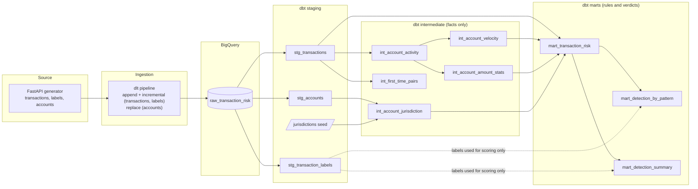

# AML Transaction Risk Monitoring Pipeline

An end-to-end analytics engineering project that ingests a live transaction feed, models it in dbt, applies rule-based AML detection logic, and **validates the detection rules against ground-truth fraud labels**.

**Stack:** Python (FastAPI generator, dlt) · BigQuery · dbt Fusion · GitHub Actions (CI) · sqlfluff

## Headline result

On 2.5M transactions (10,026 labelled fraud across 5 fraud patterns), the rule set achieves:

| Metric | Value |
|---|---|
| Recall (fraud caught) | 71.5% (7,171 of 10,026) |
| Precision | 14.3% |
| False-positive rate | 1.72% (43,005 of 2.5M normal transactions) |

Precision is low because the base fraud rate is about 0.4%, so even a 1.7% false-positive rate produces many more false alerts than true ones. Alerts are therefore ranked by how many rules fire:

| Rules triggered | Transactions | Fraud share |
|---|---|---|
| 0 | 2,459,975 | 0.12% |
| 1 | 44,111 | 11.3% |
| 2 | 6,065 | 35.8% |

An analyst reviewing the 2-rule alerts first sees roughly 1 in 3 be fraud, about 300 times the rate among unflagged transactions.

## Architecture



`int_first_time_pairs` is built and tested but not used by the detection rules (see Known limitations).

- **Generator (FastAPI):** serves a live feed of synthetic transactions with ground-truth fraud labels. Five fraud patterns are planted: `structuring`, `outlier`, `jurisdiction`, `new_payee_high_value`, `velocity`.
- **Ingestion (dlt):** `append` with an incremental cursor for transactions (timestamp) and labels (sequence number); `replace` for the static 100,000-account pool so re-runs never duplicate rows.
- **dbt layers:**
  - **Staging:** `stg_transactions`, `stg_transaction_labels`, `stg_accounts`
  - **Intermediate** (facts and metrics only, no verdicts): `int_account_activity`, `int_account_velocity`, `int_account_amount_stats`, `int_first_time_pairs`, `int_account_jurisdiction`
  - **Marts** (thresholds and verdicts): `mart_transaction_risk`, `mart_detection_by_pattern`, `mart_detection_summary`
- **Seed:** `jurisdictions.csv` maps country codes to a high-risk flag, so adding a high-risk country needs no SQL change.

## Design decisions

- **Intermediate models compute facts; marts apply thresholds.** Velocity counts and z-scores are measurements. What counts as "suspicious" is decided once, in `mart_transaction_risk`.
- **Thresholds are dbt vars** (`dbt_project.yml`), so rules can be retuned or overridden with `--vars` without editing SQL.
- **Ground-truth labels are isolated.** They appear only in `stg_transaction_labels` and the two validation marts. The detection mart never reads them.
- **Trust rule on the z-score.** The z-score is only used when an account has at least 5 prior transactions in 30 days, because a baseline built on one or two points is unreliable.
- **Tests on every layer** (unique, not_null, relationships, accepted_values), and **CI** runs sqlfluff lint and a dbt build on every pull request.

## Detection rules

| Rule | Logic | Var(s) |
|---|---|---|
| Velocity | 3 or more transactions in the last hour | `velocity_1h_threshold` = 3 |
| Amount outlier | amount z-score >= 10, with at least 5 prior transactions | `amount_z_threshold` = 10, `min_prior_txns` = 5 |
| High-risk jurisdiction + amount | sender or receiver in a high-risk country and z-score >= 3 | `jurisdiction_z_threshold` = 3 |

A transaction is flagged if any rule fires. `rules_triggered` (0 to 3) is the triage score.

### How the thresholds were chosen

Thresholds were picked from measured flag rates on normal versus fraudulent traffic, not by guesswork:

| Candidate rule | Flagged among normal | Notes |
|---|---|---|
| velocity >= 3 per hour | 0.01% | catches about 79% of velocity fraud |
| z-score >= 5 | 2.79% | about 80% catch rate on the three amount-driven patterns |
| **z-score >= 10** | **0.84%** | same catch rate, one third of the false positives |
| z-score >= 20 | 0.19% | jurisdiction catch rate falls from 74% to 65% |
| high-risk country + z >= 3 | 1.03% | lifts jurisdiction catch rate from 74% to 80% |

z >= 10 is the knee of the curve: it cuts false positives by two thirds versus z >= 5 at almost no cost in recall, while z >= 20 starts losing real fraud.

### Results by fraud pattern

| Pattern | Catch rate |
|---|---|
| velocity | 80.4% |
| outlier | 82.3% |
| jurisdiction | 80.0% |
| new_payee_high_value | 79.9% |
| structuring | 35.3% |

## Known limitations

These were measured, not assumed, and are the main avenues for improvement:

1. **First-time sender/receiver pair is not a useful signal on this data.** The generator picks counterparties at random, so about 99.99% of both fraud and normal transactions are first-time pairs. The model (`int_first_time_pairs`) is correct and kept, but it is not used in the detection rules.
2. **Structuring is only partially caught (35%).** These transactions sit in a tight band just under 10,000 (9,000 to 9,950), but no dedicated signal exists. The coverage that exists comes from incidental velocity and z-score hits. A proximity-to-reporting-threshold signal is the obvious next step.
3. **Cold-start accounts cause about 90% of the missed fraud.** Of the 1,157 missed outlier, jurisdiction and new-payee frauds, 1,042 were on accounts with fewer than 5 prior transactions, where the z-score is deliberately not used. A fallback rule using absolute amounts for thin-history accounts would address this.
4. **Low precision at the whole-rule-set level (14%).** This is driven by the 0.4% base rate and is handled by ranking on `rules_triggered`, not by tightening the thresholds.
5. **Synthetic data separates too cleanly.** Fraud amounts are far above normal amounts by construction, which flatters the amount-based rules. Real data would show more overlap.
6. **No out-of-sample test.** Thresholds were chosen using the same labels used for the final scoring. On real data these would be tuned on one period and validated on another.
7. **Jurisdiction is a weak signal alone.** About 19% of normal transactions involve a high-risk account, so it only works as a modifier alongside an amount signal.
8. **Counts drift.** The generator is a live feed, so re-running the pipeline pulls new transactions and row counts grow slightly. Figures here are a snapshot.

## Possible next steps

- Structuring signal: amount as a fraction of the reporting threshold (a dbt var), combined with repeat behaviour in a time window
- Cold-start fallback rule for accounts with thin history
- Time-based train/validation split for threshold tuning
- Orchestration (Airflow) and a dashboard (Looker Studio) on top of the marts

## Running it

Prerequisites: Python 3.x, a BigQuery project, a service-account key, and dbt Fusion (`dbtf`).

```bash
# 1. Environment
python -m venv venv
source venv/bin/activate
pip install -r requirements.txt
export GOOGLE_APPLICATION_CREDENTIALS=/path/to/service-account-key.json

# 2. Start the transaction generator (keep this running)
uvicorn main:app

# 3. In another terminal: ingest into BigQuery (dataset raw_transaction_risk)
python pipeline.py

# 4. Build the dbt project
cd dbt_transaction_risk_monitoring
dbtf seed
dbtf build

# 5. Lint
sqlfluff lint models
```

After the build, query `mart_detection_summary` and `mart_detection_by_pattern` for the validation results.
